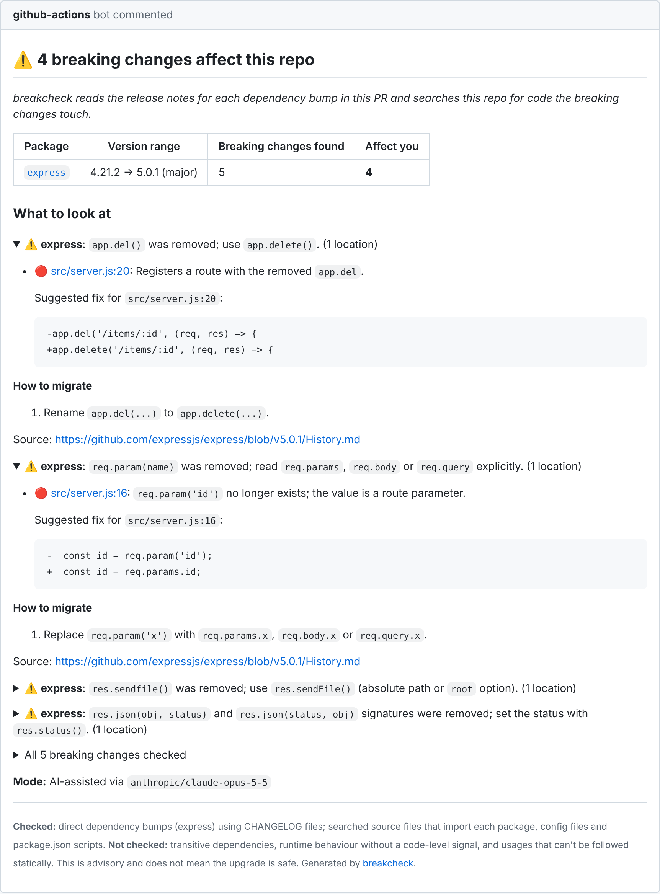

# breakcheck

**Zero setup. No API key needed.**

Dependabot and Renovate tell you *that* `express` went from 4 to 5. breakcheck tells you
**which of the breaking changes in that range hit your code, where, and how to fix them**,
in one comment on the PR.



<sub>Rendered from the end-to-end test output for express 4.21.2 → 5.0.1 (`test/e2e/__snapshots__/express.ai.md`).</sub>

## What it does (30 seconds)

On every pull request that touches `package.json` or a lockfile, breakcheck:

1. **Detects the bumps.** It diffs the base and head manifests and lockfiles (npm, pnpm, yarn classic and berry) and keeps direct dependencies only. Patch bumps are skipped unless you set `include-patch`.
2. **Reads the release notes for exactly that range.** It finds the GitHub repo through the npm registry and reads GitHub Releases, falling back to `CHANGELOG.md`/`History.md` at the tag. For major bumps it also reads the migration guide. Monorepo tags such as `pkg@1.2.3` and `pkg-v1.2.3` are handled.
3. **Extracts the breaking changes** as structured data: affected exports, options, CLI flags and config keys, plus migration steps.
4. **Finds usages deterministically** with the TypeScript compiler (ts-morph). Aliased, default, namespace, `require()` and dynamic imports are resolved, and config files and `package.json` scripts are searched too.
5. **Type-checks the upgrade** (TypeScript projects). It downloads the old and new version of the package from the npm registry, type-checks the files that import it against each, and reports every error that only the new version produces. This finds compile-level breaks even when the release notes never mention them, confirms note-based matches the compiler rejects, and rules out "removed export" claims for names that still exist.
6. **Verifies each hit** with a model that sees only a ±10-line snippet, then gives a yes/no/unsure verdict and a suggested fix.
7. **Posts one comment** and updates it in place on every re-run. The comment shows a headline, a per-package table, one collapsible section per affected change with `file:line` links, the mode that produced the result, and what was and wasn't checked.

It never says an upgrade is "safe". It says what it checked.

## Quick start

Add `.github/workflows/breakcheck.yml`:

```yaml
name: breakcheck

on:
  pull_request:
    paths:
      - '**/package.json'
      - '**/package-lock.json'
      - '**/npm-shrinkwrap.json'
      - '**/pnpm-lock.yaml'
      - '**/yarn.lock'

permissions:
  contents: read
  pull-requests: write
  # Lets breakcheck use GitHub Copilot with the workflow token (no API key).
  # Remove this line to stay rule-based only.
  copilot-requests: write

jobs:
  breakcheck:
    runs-on: ubuntu-latest
    steps:
      - uses: actions/checkout@v5
      - uses: unknowndevice077/breakcheck@v0
```

That's it. No secrets to create.

> Use `pull_request`, not `pull_request_target`. breakcheck reads the checked-out code, so it must never run with a write token against untrusted PR code.

## Where the AI comes from

| `provider` | Needs | Notes |
| --- | --- | --- |
| `copilot` **(default)** | `permissions: copilot-requests: write` and a Copilot plan on the account that owns the repo. **Copilot Free works.** | Runs the official Copilot CLI with the workflow's `GITHUB_TOKEN`. In a personal repo, usage counts against the owner's Copilot allowance. In an organization repo it is billed to the organization, and the org policy *"Allow use of Copilot CLI billed to the organization"* must be on (it is by default when Copilot CLI is enabled). Copilot Free offers automatic model selection only, so the default `model` is `auto`. |
| `anthropic` | `api-key` | Default model `claude-opus-5-5`. Set `model: claude-haiku-5-5` for a cheaper run. |
| `openai` | `api-key` | Default model `gpt-5.5`. |
| `none` | nothing | Rule-based only. |

**If the AI isn't available for any reason, the job doesn't fail.** That covers a missing permission, no Copilot plan, a rate limit, a timeout, a network error, or invalid output twice in a row. breakcheck switches to rule-based mode and says so in the comment (`Rule-based (no AI available), lower confidence: …`). The job summary lists every model call with its duration and token usage. The Copilot CLI doesn't report token counts.

> **About GitHub Models.** breakcheck was designed around GitHub Models, the keyless inference API for `GITHUB_TOKEN`. GitHub [retired GitHub Models on 2026-07-30](https://docs.github.com/github-models): the inference API, catalog and `models: read` permission are gone. Copilot CLI with `GITHUB_TOKEN` is GitHub's documented replacement for keyless AI in Actions. `provider: github-models` still works as an alias for `copilot`.

### How many calls a run makes

Per bumped package, breakcheck makes **1 extraction call**, plus **1 verification call per 8 matched locations**. Verification is skipped entirely when nothing matched. Extraction results are cached with `actions/cache`, keyed by package, version range and model, so re-runs and repeated upgrades don't call the model again. `max-packages` (default 10) caps the work per run, analysing majors first.

GitHub's cache is scoped by branch. A PR can read caches created on its own branch and on the base branch, so sharing across PRs starts once the base branch has a cached entry.

### Switching providers

```yaml
      - uses: unknowndevice077/breakcheck@v0
        with:
          provider: anthropic            # or openai
          api-key: ${{ secrets.ANTHROPIC_API_KEY }}
          model: claude-haiku-5-5        # optional
```

## Dependabot PRs (the #1 setup problem)

Workflows triggered by Dependabot run with restrictions:

- **The `GITHUB_TOKEN` is read-only by default.** GitHub documents that the workflow's `permissions:` block can raise it. Keep `pull-requests: write` in the workflow, as in the quick start, or breakcheck cannot comment.
- **Only *Dependabot secrets* are available. Actions secrets are not.** If you use `anthropic` or `openai`, store the key under *Settings → Secrets and variables → Dependabot* too, with the same name as the Actions secret.
- **Copilot on Dependabot runs.** GitHub's docs don't say whether `copilot-requests: write` is honoured for Dependabot-triggered runs, and I could not verify it. If it isn't, breakcheck falls back to rule-based mode and the comment says why.
- **Re-runs keep the original privileges.** Re-running a Dependabot workflow uses Dependabot's token even when someone else clicks "Re-run".

PRs from forks get a read-only token that `permissions:` cannot raise, so breakcheck cannot comment there. It logs a warning instead of failing.

## Privacy

- The model sees only:
  - the release notes;
  - for each matched location, a ±10-line snippet, its path and line number, and the breaking change it may be affected by.
- Whole files and the repo are never sent. If nothing matches, no code is sent at all.
- Secret-bearing files (`.env*`, `.npmrc`, `.yarnrc*`, key and credential files) are never read.
- Token-shaped strings in snippets are replaced with `[redacted]` before they leave the runner. This covers API keys, GitHub/AWS/Slack/Google tokens, JWTs, private keys, and values assigned to `password`/`token`/`apiKey`-like names.
- With `copilot`, the CLI runs in an empty temporary directory, with shell and write tools denied and only the token in its environment. The only thing it receives is the prompt.
- The type-check runs on the runner. It downloads the bumped packages' tarballs from your npm registry (`npm_config_registry`) and sends nothing anywhere.
- Snippets go to the provider you chose, under that provider's terms (GitHub Copilot, Anthropic or OpenAI).

## Inputs

| Input | Default | |
| --- | --- | --- |
| `provider` | `copilot` | `copilot`, `anthropic`, `openai` or `none` |
| `api-key` | | For `anthropic`/`openai` |
| `model` | provider default | `auto` (copilot), `claude-opus-5-5`, `gpt-5.5` |
| `github-token` | `${{ github.token }}` | Used for GitHub API calls, the comment and Copilot |
| `include-patch` | `false` | Also analyse `x.y.Z` bumps |
| `max-packages` | `10` | Packages per run, majors first |
| `fail-on-affected` | `false` | Fail the check when anything is affected or possibly affected |
| `typecheck` | `true` | Type-check importing TypeScript files against the old and new type declarations |
| `copilot-cli-version` | `1.0.96` | Version of `@github/copilot` to run |

Outputs: `affected-count`, `possibly-affected-count`, `mode` (`ai`/`rules`/`mixed`), `comment-url`.

## Reading the comment

- **Headline** is one of:
  - `⚠️ N breaking changes affect this repo`
  - `⚠️ N breaking changes may affect this repo`
  - `✅ No breaking changes found that affect your code (N checked)`
  - `❓ Couldn't find release notes for X`
- **🔴** marks a location the model confirmed is affected. It comes with a reason and, usually, a suggested diff.
- **🟡 _(unsure)_** marks a location the model couldn't decide on.
- **🟡 _(possibly)_** marks a rule-based match. No model checked it, so expect some false positives.
- **All N breaking changes checked** lists every change found, including the ones with no usages and the ones that can't be searched for, such as "requires Node 20". Review those yourself.
- **Couldn't analyse** lists dynamic `import(variable)` calls, `export * from 'pkg'`, unparsable files and capped result lists.

## Limitations

- **JavaScript/TypeScript with npm, pnpm or yarn only.** Only direct dependencies are analysed.
- **Vue, Svelte and Astro components** are searched through their `<script>` blocks (and Astro frontmatter). Template expressions are only covered by text patterns, not by symbol search.
- **The type-check sees compile-level breaks only.** It covers `.ts`/`.tsx` files that import the package, with the repo's `tsconfig.json` options. Other dependencies aren't installed, so their types are `any`; that can hide an error but never invents one. Packages typed by `@types/*` are checked when the `@types/*` package itself is bumped. Behaviour changes that still compile rely on the release notes.
- **Usage search is static.** Instance members such as `res.json` are matched by property name in files that import the package, so the AI step or a human needs to confirm them. Values passed around through variables, `eval` and string-built imports are not followed.
- **The finder only sees what the release notes say.** If a project doesn't document a break, breakcheck can't know about it. Projects without GitHub releases or a changelog get the ❓ headline.
  - Example: ESLint 9 rejects `--ext` under flat config, but neither the v9 release notes nor the v9 migration guide name the flag. breakcheck flags your `.eslintrc*` file, not the `--ext` in your scripts.
- **Long upgrades are summarised to fit.** For a range like react-router 6.30 → 7.18 (50+ releases), the notes are cut to about 30k characters, keeping Breaking/Removed/Migration sections first. A rule-based pass over the same notes acts as a safety net for anything the model leaves out.
- **Migration guides are read when they live in the package's GitHub repo.** Guides hosted only on a separate website are linked, not read.
- **Rule-based mode is a heuristic.** It reads Breaking/Removed/Deprecated/Migration sections, `type!:` commits and backticked identifiers. It finds more candidates and fewer exact matches than AI mode.

## Roadmap

Not in v1:

- More ecosystems: Maven/Gradle, pip, Go modules
- Committing suggested fixes automatically
- A hosted GitHub App version

## Name

`breakcheck` is a working name. It is free on npm, and a web search found no Marketplace action with that name; check the Marketplace yourself before publishing. Alternatives that are also free on npm: `bumpwise`, `breakwatch`, `upgrade-impact`.

## Development

```sh
npm ci
npm run lint && npm run typecheck && npm test
npm run build   # bundles to dist/ with @vercel/ncc; commit the result
```

CI runs lint, typecheck and tests, and fails if `dist/` doesn't match a fresh build.

**Tests never touch the live network.**

- **End-to-end tests** cover react-router 6→7, express 4→5, eslint 8→9 and next 14→15. Each runs in both AI and rule-based modes.
  - Real changelogs, migration guides and npm metadata are fixtures under `test/fixtures/upstream` and `test/fixtures/e2e/registry`; see the README there for provenance.
  - GitHub API responses are served in their documented shapes by an injected `fetch`.
  - Model replies are canned per scenario (`test/fixtures/e2e/*/model.json`) and returned in the provider's wire format, so the real SDK parsing runs. They were written for these tests, not captured from live model calls.
- **Snapshots** of the rendered comment for each headline state are in `test/e2e/__snapshots__/`.
- **`test/dist.test.ts`** runs the bundled `dist/index.js` as a real action process against a local server.

**Tested on real GitHub Actions.** A demo PR bumped express 4.22 → 5.3, eslint 8.57 → 9.39 and react-router 6.30 → 7.18 on a dummy app with planted breakages ([unknowndevice077/breakcheck#1](https://github.com/unknowndevice077/breakcheck/pull/1)). Copilot with `GITHUB_TOKEN` worked with no secrets.

- **Found:** every planted break except `eslint --ext` (see Limitations), including a removed export imported under an alias (`json as toJson`).
- **Comment:** updated in place on each re-run.
- **Cache:** re-runs took about 1 minute instead of about 3.5.
- **Fixed after those runs:**
  - release notes that only point to the CHANGELOG;
  - empty version headers using up the size budget;
  - file globs that matched every file.

A second round on a Vue 3 app with a yarn berry lockfile (pinia 2 → 3, vue-i18n 9 → 11, [unknowndevice077/breakcheck#4](https://github.com/unknowndevice077/breakcheck/pull/4)) found `defineStore({ id })`, `allowComposition`, `i18n.global.tc` and every `$tc(...)`. That includes `$tc` in templates and in an Options API component that never imports vue-i18n. A planted `PiniaVuePlugin` import was not flagged, because pinia's v3 notes don't mention it.

To try it on a real repo, see [`examples/`](examples/).

## License

[MIT](LICENSE)
